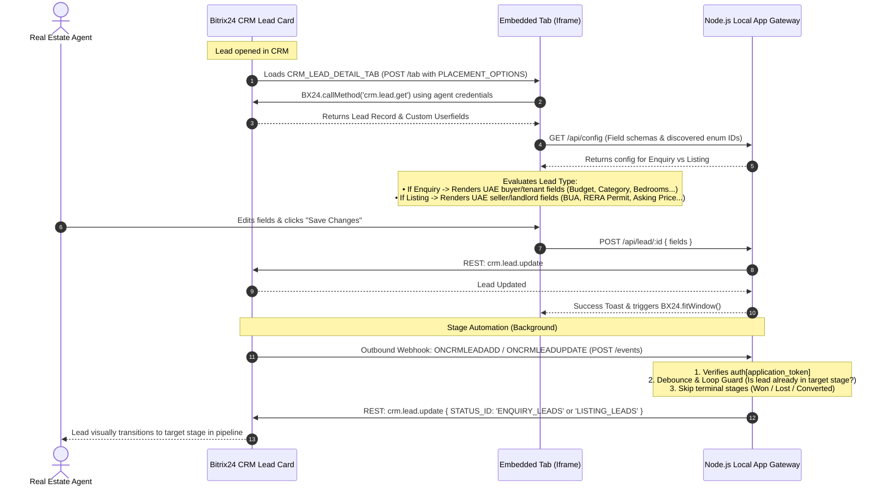

# Bitrix24 Real Estate CRM — Lead Details Tab & Stage Router

A production-grade Bitrix24 Local Application (server-side, Node.js 20 + Express) engineered for UAE real estate agencies. 

It embeds a dynamic **Lead Details** tab into the native Bitrix24 Lead card (`CRM_LEAD_DETAIL_TAB`) displaying only the fields relevant to the lead's type (**Enquiry** vs. **Listing**), saves edits directly back to the CRM, and automatically shifts leads into designated pipeline stages (**Enquiry Leads** vs. **Listing Leads**).

---

## 🏛 Architecture & Data Flow



---

## 📁 Project Directory Structure

```
d:/Bitrix24 automation/
├── config/
│   └── fields.json            # Dynamic field schemas for Enquiry & Listing
├── storage/
│   └── tokens.json            # Persistent OAuth tokens & discovered stages (atomic write)
├── public/
│   ├── css/
│   │   ├── tab.css            # Native Bitrix24 styling & RTL support for Arabic labels
│   │   └── admin.css          # Admin portal styling
│   └── js/
│       ├── tab.js             # Client-side tab controller using official BX24 SDK
│       └── admin.js           # Admin portal controller (discovery & custom field creator)
├── views/
│   ├── tab.html               # Custom tab page rendered inside lead card iframe
│   ├── install.html           # Initial app installation wizard
│   └── admin.html             # Visual field & stage management dashboard
├── src/
│   ├── config.js              # Environment variable parser & config loader
│   ├── storage.js             # Atomic JSON storage for OAuth tokens & discovery cache
│   ├── bitrixClient.js        # Server-side REST client with automatic token refresh
│   ├── discovery.js           # REST discovery for Lead Type, stages, and userfields
│   ├── eventRouter.js         # Event-driven stage router with recursion loop guard
│   └── middleware/
│       ├── auth.js            # Token & admin secret verification
│       └── rateLimiter.js     # Express rate limiters for API & events
├── server.js                  # Main Express application & routes
├── test-suite.js              # 27 automated test cases covering all requirements
├── Dockerfile                 # Container image specification (Node 20 Alpine)
├── .env.example               # Environment variables template
└── README.md                  # Complete operational manual
```

---

## 🚀 Setup & Deployment Guide

### Step 1: Deploy to an HTTPS Host
Bitrix24 iframes and event webhooks require a valid HTTPS URL.

#### Option A: Local Testing with an HTTPS Tunnel (ngrok / Cloudflare Tunnel)
```bash
# In your terminal:
ngrok http 3000
# Output provides: https://your-subdomain.ngrok-free.app
```
Copy `https://your-subdomain.ngrok-free.app` and set it as `PUBLIC_URL` in your `.env`.

#### Option B: Docker Deployment (VPS / Cloud)
```bash
# Build image
docker build -t bitrix24-lead-app .

# Run container
docker run -d -p 3000:3000 \
  -e PUBLIC_URL="https://crm-app.yourcompany.ae" \
  -e CLIENT_ID="app.xxxx" \
  -e CLIENT_SECRET="xxxx" \
  -e ADMIN_SECRET="your_secret" \
  --name bitrix24-lead-app bitrix24-lead-app
```

---

### Step 2: Register Local Application in Bitrix24

1. Open your Bitrix24 portal as an Administrator.
2. In the left menu, go to **Developer Resources ➔ Other ➔ Local application**.
3. Fill in the application registration details:
   - **Type of application**: Select **Server-side (for automated scripts or webhooks)**.
   - **Application Name**: `Real Estate Lead Details & Router`.
   - **Handler Path**: `https://your-domain.ngrok-free.app/tab`
   - **Initial Install Path**: `https://your-domain.ngrok-free.app/install`
   - **Access Permissions (Scopes)**: Tick the following checkboxes:
     - `CRM` (Customer Relationship Management)
     - `Placement` (Application embedding points)
4. Click **Save**.
5. Bitrix24 will generate an **Application ID (`CLIENT_ID`)** and **Secret Key (`CLIENT_SECRET`)**.
6. Copy them into your `.env` file:
   ```env
   PORT=3000
   PUBLIC_URL=https://your-subdomain.ngrok-free.app
   CLIENT_ID=app.xxxxxxxxxxxxxxxxxxxxxxxx.xxxxxxxx
   CLIENT_SECRET=xxxxxxxxxxxxxxxxxxxxxxxxxxxxxxxx
   ADMIN_SECRET=uae_realestate_secret_2026
   ```
7. Start your server:
   ```bash
   npm start
   # or with auto-reload:
   npm run dev
   ```

---

### Step 3: Complete Installation in Bitrix24

1. Back in Bitrix24, click **Install** on your application card.
2. The installation wizard at `/install` will execute:
   - Saves initial OAuth tokens (`access_token`, `refresh_token`, `domain`).
   - Registers placement `CRM_LEAD_DETAIL_TAB` pointing to `/tab`.
   - Binds events `ONCRMLEADADD` and `ONCRMLEADUPDATE` pointing to `/events`.
   - Runs discovery for the Lead Type field and stages.
   - Calls `BX24.installFinish()` to complete the install.

---

### Step 4: Verify the Tab in Bitrix24 Lead Card

1. Navigate to **CRM ➔ Leads**.
2. Click on any existing Lead or click **+ Add Lead**.
3. In the Lead card header tab bar, look for the new tab titled **Lead Details** (if tabs are crowded, click **More ➔ Lead Details**).
4. Click **Lead Details**:
   - If the lead has **Lead Type** set to *Enquiry*, only Enquiry fields (Category, Bedrooms, Budget AED, Financing...) are rendered.
   - If the lead has **Lead Type** set to *Listing*, only Listing fields (BUA, RERA Permit, Asking Price, Building Name...) are rendered.
   - If Lead Type is not set, a warning prompts the user to select the Lead Type.
5. Edit any field and click **Save Changes**: a green toast appears and the lead card is updated!

---

### Step 5: Visual Field & Schema Manager (`/admin`)

Access the Admin dashboard at `https://your-domain/admin`:
1. Enter your `ADMIN_SECRET` to unlock the console.
2. **Lead Type Discovery**: Shows whether `UF_CRM_LEAD_TYPE` was found and lists its enum item IDs.
3. **Pipeline Stages**: Shows whether `Enquiry Leads` and `Listing Leads` exist. If missing, click **+ Auto-create Missing Stages** to create them directly in Bitrix24 via `crm.status.add`.
4. **Custom Field Presence**: Checks which configured fields exist on the Lead entity in Bitrix24. Click **⚡ Auto-Create All Missing Fields in Bitrix24** to create any missing custom fields with one click.
5. **Create Custom Field**: Allows creating new fields on the Lead card and assigning them to Enquiry or Listing tabs directly from the browser!

---

## 🛠 Modifying Fields via `config/fields.json`

You can customize the tab fields at any time by editing `config/fields.json`:

```json
{
  "code": "UF_CRM_TARGET_COMMUNITY",
  "label": "Target Community / Area",
  "type": "string",
  "required": true,
  "placeholder": "e.g., Downtown Dubai, Dubai Marina"
}
```

Supported field types:
- `string`: Single-line text input
- `text`: Multiline text area
- `number`: Numeric input
- `money`: Formatted financial input (AED)
- `date`: HTML5 date picker (`YYYY-MM-DD`)
- `boolean`: Checkbox toggle (`Y` / `N`)
- `enumeration`: Dropdown list (options populated from `options` array or Bitrix24 enum list)

---

## 🧪 Automated Test Suite

Run the 27-case automated test suite:
```bash
npm test
```

### Covered Test Scenarios:
| # | Scenario | Expected Result | Status |
|---|---|---|---|
| 1 | Listing lead created/updated | Automatically moves to `LISTING_LEADS` stage | ✓ PASS |
| 2 | Enquiry lead created/updated | Automatically moves to `ENQUIRY_LEADS` stage | ✓ PASS |
| 3 | Lead with empty Lead Type | Update safely skipped; warning logged | ✓ PASS |
| 4 | Lead Type changed from Enquiry to Listing | Router detects change and shifts stage to `LISTING_LEADS` | ✓ PASS |
| 5 | Expired OAuth token (`expired_token`) | Automatically refreshed via `refresh_token` and retried | ✓ PASS |
| 6 | Duplicate events & recursion loop | Debounce guard (4s window) & stage check prevents circular loops | ✓ PASS |
| 7 | Lead already in Won/Lost/Converted stage | Routing skipped to avoid reopening closed leads | ✓ PASS |
| 8 | Dynamic field schemas in `fields.json` | Validates UAE real estate fields (Budget AED, RERA permit) | ✓ PASS |

---

## 🔍 Troubleshooting & FAQs

### 1. Iframe is blank or says "refused to connect"
- **Cause**: Browser blocked iframing due to CSP `frame-ancestors` or `X-Frame-Options: DENY`.
- **Solution**: The application uses Helmet with `frameguard: false` and explicitly includes CSP directives for `*.bitrix24.com`, `*.bitrix24.ae`, `*.bitrix24.eu`, and `*.bitrix24.in`. Ensure you are accessing via `https://` and that your Bitrix portal domain matches the allowed CSP list.

### 2. "Lead Details" tab does not appear in Lead Card
- Check that the application was granted the `Placement` scope in Bitrix24.
- Open your browser console inside Bitrix24 and verify that `placement.bind` returned `true`.
- In the Lead card, look under the **More** dropdown at the far right of the tab row.

### 3. "Expired token" or 401 Unauthorized errors in logs
- Bitrix24 access tokens expire every 1 hour.
- The `BitrixClient` automatically detects `expired_token` responses and executes the `refresh_token` flow against `https://oauth.bitrix.info/oauth/token/`. Ensure `CLIENT_ID` and `CLIENT_SECRET` in `.env` are correct.

### 4. What changes if my portal is Bitrix24 On-Premise (Box edition)?
- In `.env`, set `IS_BOX=true`.
- In On-Premise, OAuth token renewal requests are sent directly to `https://<your-box-domain>/oauth/token/` instead of `oauth.bitrix.info`.
- Add your internal domain to the CSP `frame-ancestors` directive in `server.js`.
